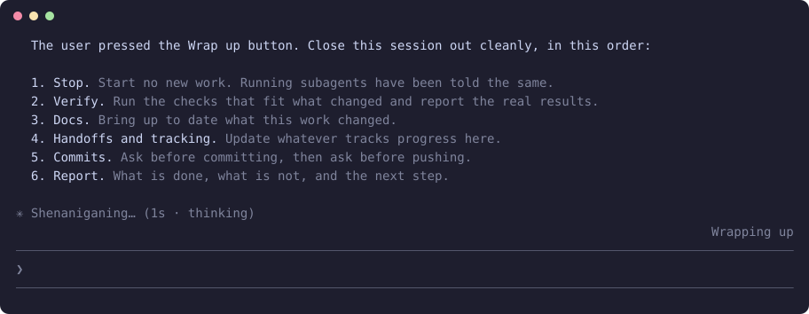

<h1 align="center">claude-wrap-up</h1>

<p align="center"><b>One button to finish a session properly: stop, verify, update the docs, leave a handoff, then ask before you commit.</b></p>

<p align="center">
  
  
  
  
</p>

<p align="center"></p>

<p align="center"><sub>Only this mod enabled, in a real terminal session. The button shows Wrapping up while the checklist runs.</sub></p>

Sessions rarely end cleanly. Press Wrap up and the session and its subagents stop at a suitable moment, then work through the same checklist every time, so less gets left uncommitted or undocumented by accident.

## Install

In a terminal, inside Claude Code:

```
/plugin install wrap-up --marketplace YlitaloJuha/claude-wrap-up
```

Or from a shell:

```bash
claude plugin install wrap-up --marketplace YlitaloJuha/claude-wrap-up
```

In the desktop app, click + next to the prompt box, then Plugins, Add marketplace with `YlitaloJuha/claude-wrap-up`, then Add plugin.

## What it does

- **Stops gently:** Running subagents get a message to finish, and a running turn hears it on its next tool result.
- **Same checklist every time:** Stop, verify, docs, handoffs and tracking, commits, report.
- **Docs before commits:** Docs and handoffs come first, so they land in the same commit.
- **Your call on Git:** It asks before committing, then asks again before pushing.

## Commands

| Command | What it does |
|---|---|
| `/wrap-up` | Start wrapping up |

## What it costs

One normal Claude turn for the checklist, plus whatever the checks need. The mod makes no extra model calls.

## What it can reach

No network, no shell commands and no file access through the mod API. It lists your subagents, sends them one message, and queues the checklist as a prompt. Run `claude plugin validate .` in this repository to list every call it makes.

## Limits

- It tells the subagents of this session. Separate sessions you started from the app are not told.
- A permission prompt during the checklist waits for you, as usual.
- The checklist is instructions to Claude, and Claude can miss a step. Check the result yourself.
- It draws its own Wrap up button after your first turn. With [`claude-bars`](https://github.com/YlitaloJuha/claude-bars) installed, the button moves onto that line.
- Tested in real sessions, including clicks on the button in the desktop app.
- Claude Code draws the band above the prompt only in the terminal and the desktop app, so what this mod draws there does not show in VS Code or on mobile.

## Develop

```bash
claude plugin validate .
claude plugin test .
claude --plugin-dir .
```

## Make it yours

Once it is loaded, ask your own Claude to fit it to how you work, for example to make the checklist match how your team ships. The code is in `hooks/register.tsx`, and the license allows changes. Keep your version in a fork, so an update does not replace it. What you change is yours to check.

## Try other mods together

This mod works on its own, and it also works side by side with my other Claude Code mods. See [the full list on my profile](https://github.com/YlitaloJuha/YlitaloJuha#claude-code-mods).

## License and warranty

[MIT](LICENSE).

Provided **as is, with no warranty of any kind**. You use it at your own risk, and the author is not liable for anything that results from using it, including lost work, usage charges or changes to your code.

**It may break.** It relies on how Claude Code works today, and has been tested on versions 2.1.292 and 2.1.309. It may stop working after a future update if Anthropic changes things.

This is an independent, unofficial project. It is not affiliated with, endorsed by or supported by Anthropic.
